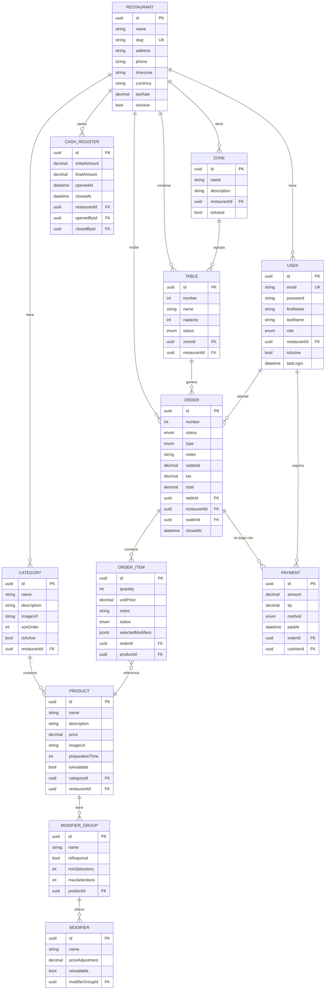
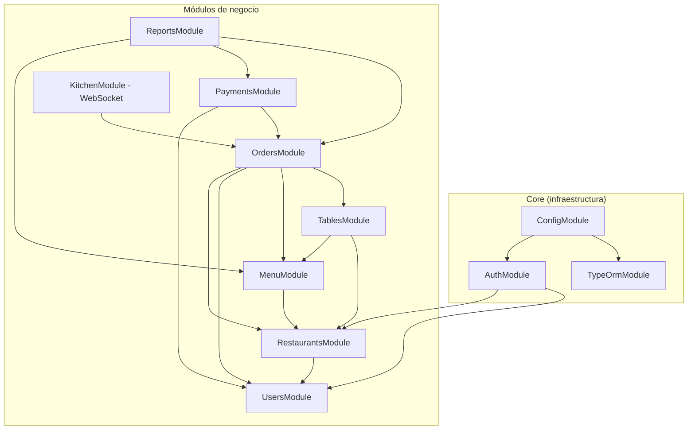
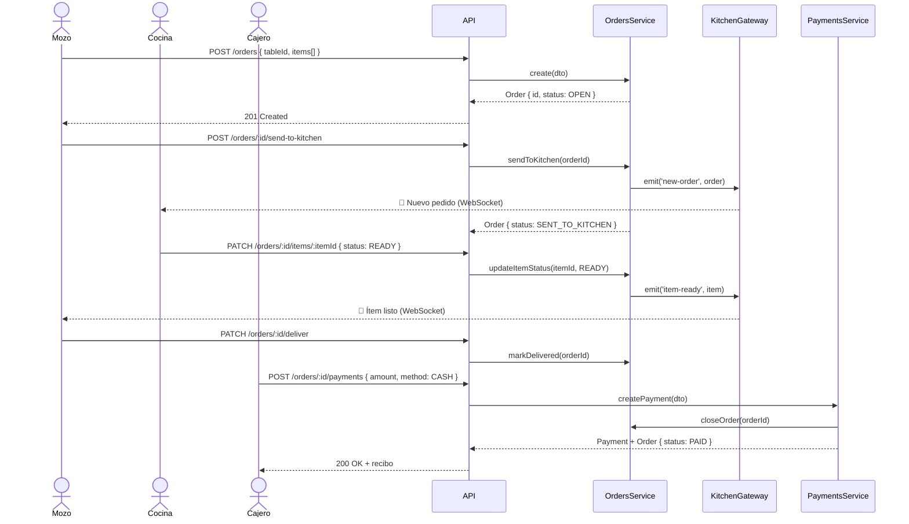
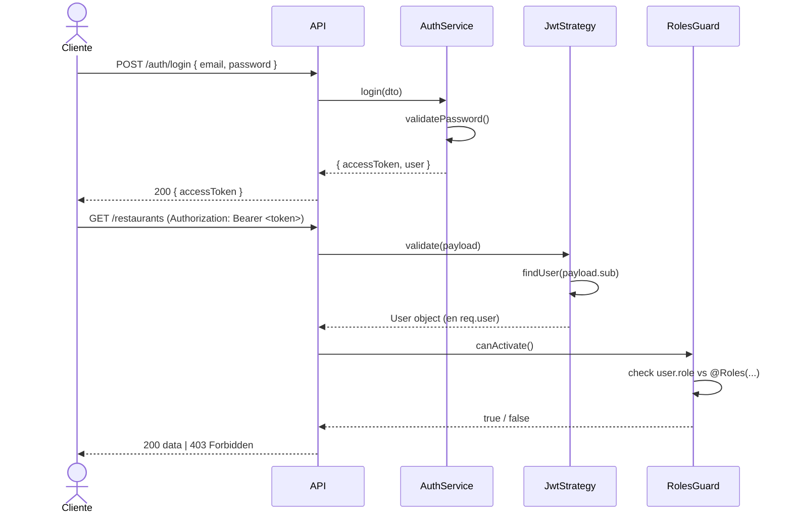
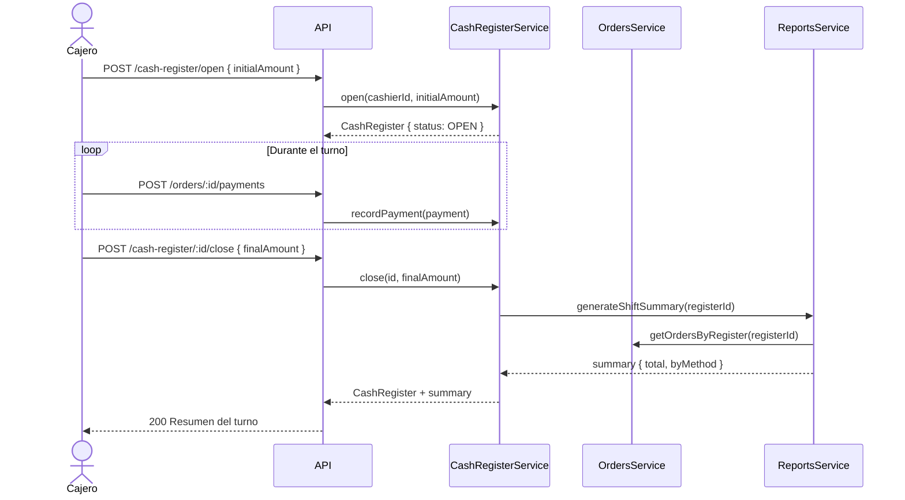
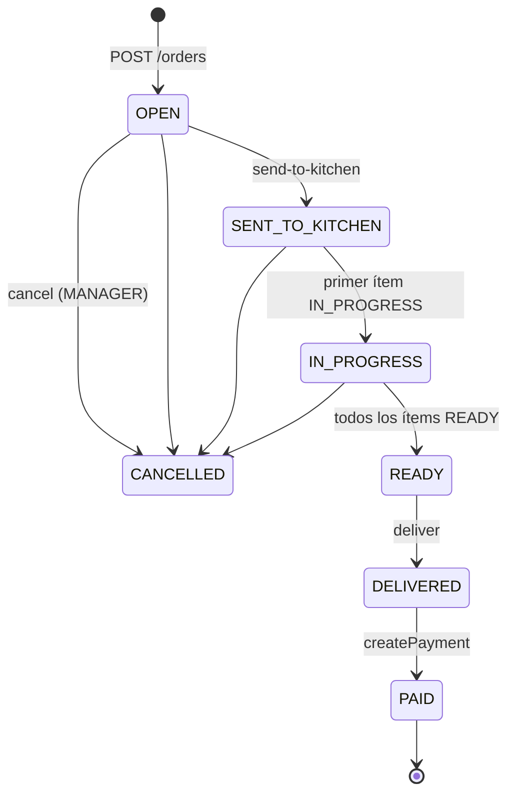
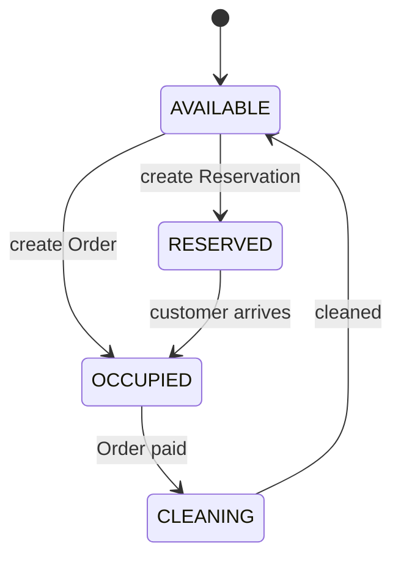
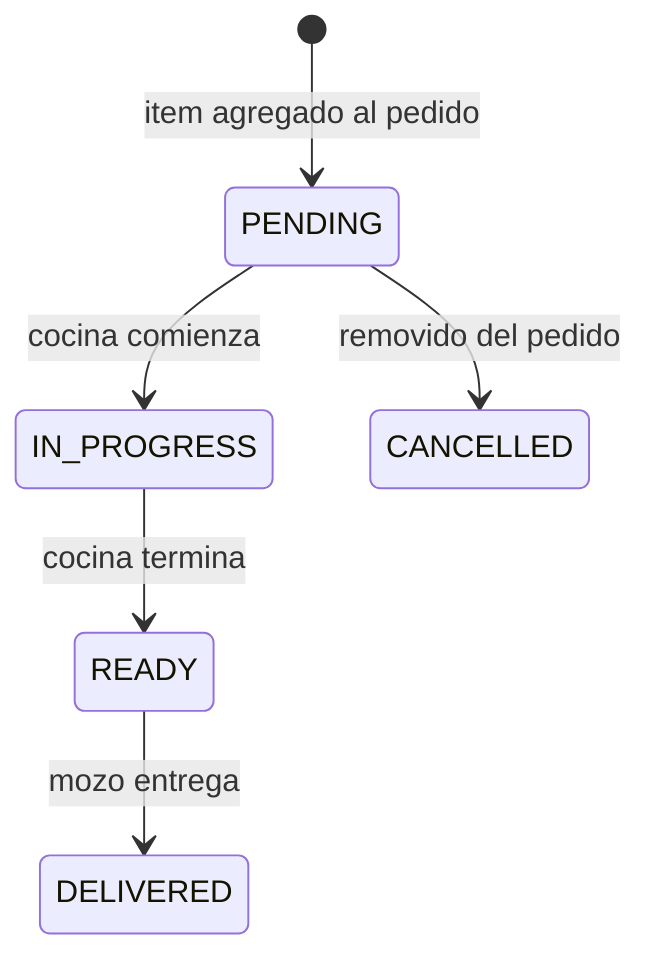

# 🏗️ GastroManager — Arquitectura & Domain Model

> Documento vivo. Refleja el estado del sistema y guía el código. Actualizar antes de programar.

---

## 1. Modelo de Dominio — Entidades y sus relaciones

Este diagrama muestra **qué existe** en el sistema y **cómo se relaciona**. Es la base de todo el resto.

---

## 2. Mapa de Módulos y Dependencias

Muestra **qué módulo depende de qué**. Si hay un ciclo → problema de diseño.

> [!IMPORTANT]
> La dirección de las flechas = "depende de". `OrdersModule` depende de `TablesModule` y `MenuModule`, pero **nunca al revés**. Esto evita dependencias circulares.

---

## 3. Flujos de Negocio (Secuencias)

### 3.1 — Flujo completo de un pedido (Dine-In)

### 3.2 — Flujo de autenticación y autorización

### 3.3 — Flujo de apertura y cierre de caja

---

## 4. Contratos de API — Endpoints por módulo

### Auth
| Método | Endpoint | Rol requerido | Descripción |
|--------|----------|---------------|-------------|
| `POST` | `/auth/register` | — | Registrar usuario |
| `POST` | `/auth/login` | — | Login, retorna JWT |
| `GET` | `/auth/me` | Autenticado | Perfil propio |

### Restaurants
| Método | Endpoint | Rol requerido | Descripción |
|--------|----------|---------------|-------------|
| `POST` | `/restaurants` | OWNER | Crear restaurante |
| `GET` | `/restaurants` | Autenticado | Listar todos |
| `GET` | `/restaurants/:id` | Autenticado | Ver detalle |
| `PATCH` | `/restaurants/:id` | OWNER, MANAGER | Editar |
| `DELETE` | `/restaurants/:id` | OWNER | Desactivar |

### Tables
| Método | Endpoint | Rol requerido | Descripción |
|--------|----------|---------------|-------------|
| `GET` | `/restaurants/:rid/zones` | Autenticado | Listar zonas |
| `POST` | `/restaurants/:rid/zones` | MANAGER | Crear zona |
| `GET` | `/restaurants/:rid/tables` | Autenticado | Listar mesas (con estado) |
| `POST` | `/restaurants/:rid/tables` | MANAGER | Crear mesa |
| `PATCH` | `/tables/:id/status` | WAITER | Cambiar estado |

### Menu
| Método | Endpoint | Rol requerido | Descripción |
|--------|----------|---------------|-------------|
| `GET` | `/restaurants/:rid/categories` | Autenticado | Listar categorías |
| `POST` | `/restaurants/:rid/categories` | MANAGER | Crear categoría |
| `GET` | `/restaurants/:rid/products` | Autenticado | Listar productos (con filtros) |
| `POST` | `/restaurants/:rid/products` | MANAGER | Crear producto |
| `PATCH` | `/products/:id/availability` | MANAGER, KITCHEN | Marcar disponible/no disponible |
| `POST` | `/products/:id/modifier-groups` | MANAGER | Agregar grupo de modificadores |

### Orders
| Método | Endpoint | Rol requerido | Descripción |
|--------|----------|---------------|-------------|
| `POST` | `/orders` | WAITER | Crear pedido |
| `GET` | `/orders` | WAITER, MANAGER | Listar pedidos activos |
| `GET` | `/orders/:id` | Autenticado | Ver pedido |
| `POST` | `/orders/:id/items` | WAITER | Agregar ítem |
| `DELETE` | `/orders/:id/items/:itemId` | WAITER, MANAGER | Quitar ítem |
| `POST` | `/orders/:id/send-to-kitchen` | WAITER | Enviar a cocina |
| `PATCH` | `/orders/:id/items/:itemId/status` | KITCHEN | Actualizar estado del ítem |
| `PATCH` | `/orders/:id/deliver` | WAITER | Marcar entregado |
| `POST` | `/orders/:id/cancel` | MANAGER | Cancelar pedido |

### Payments
| Método | Endpoint | Rol requerido | Descripción |
|--------|----------|---------------|-------------|
| `POST` | `/orders/:id/payments` | CASHIER | Registrar pago |
| `GET` | `/orders/:id/payments` | Autenticado | Ver pagos de un pedido |
| `POST` | `/cash-register/open` | CASHIER | Abrir caja |
| `POST` | `/cash-register/:id/close` | CASHIER | Cerrar caja con resumen |

### Reports
| Método | Endpoint | Rol requerido | Descripción |
|--------|----------|---------------|-------------|
| `GET` | `/reports/sales` | OWNER, MANAGER | Ventas por rango de fechas |
| `GET` | `/reports/top-products` | OWNER, MANAGER | Productos más vendidos |
| `GET` | `/reports/by-waiter` | MANAGER | Ventas por mozo |
| `GET` | `/reports/cash-register/:id` | CASHIER, MANAGER | Resumen de caja |

---

## 5. Estados y Transiciones

### Order Status — Máquina de estados

### Table Status

### OrderItem Status

---

## 6. Reglas de Negocio Críticas

> [!IMPORTANT]
> Estas reglas **deben validarse en la capa de Service**, nunca solo en el DTO.

| # | Regla | Módulo | Dónde validar |
|---|-------|--------|---------------|
| R1 | Un pedido solo puede editarse si está en estado `OPEN` | Orders | `OrdersService.addItem()` |
| R2 | No se puede pagar un pedido si no está en `DELIVERED` | Payments | `PaymentsService.create()` |
| R3 | Una mesa `OCCUPIED` no puede recibir un nuevo pedido | Orders | `OrdersService.create()` |
| R4 | El total del pago debe cubrir el total del pedido | Payments | `PaymentsService.create()` |
| R5 | Solo el `OWNER` puede crear/eliminar productos y categorías | Menu | `RolesGuard` |
| R6 | Un `WAITER` solo ve los pedidos de su restaurante | Orders | `OrdersService.findAll()` |
| R7 | El slug de restaurante es único en todo el sistema | Restaurants | `RestaurantsService.create()` |
| R8 | Un usuario pertenece a un solo restaurante a la vez | Users | `UsersService.assignToRestaurant()` |
| R9 | No se puede cerrar caja si hay pedidos abiertos | CashRegister | `CashRegisterService.close()` |
| R10 | El precio del ítem se fija al momento de crear el pedido | Orders | `OrdersService.addItem()` |

---

## 7. Decisiones Técnicas (ADR)

### ADR-001: Multi-tenancy por `restaurantId` en cada entidad
**Decisión:** Cada entidad de negocio tiene `restaurantId` como FK.
**Alternativa descartada:** Schemas separados por restaurante en PostgreSQL.
**Razón:** Más simple de implementar y escalar en esta etapa. Con Row-Level Security de Postgres podemos aislar datos igualmente.

### ADR-002: Soft delete en lugar de hard delete
**Decisión:** `isActive: false` en lugar de `DELETE FROM`.
**Razón:** Preservar historial de pedidos y reportes. Un producto eliminado que estuvo en pedidos históricos debe seguir siendo consultable.

### ADR-003: Precio fijado en el `OrderItem`
**Decisión:** `unitPrice` se copia del `Product.price` al momento de crear el ítem.
**Razón:** Si el precio del producto cambia, los pedidos históricos no deben verse afectados.

### ADR-004: WebSocket solo para Kitchen Display
**Decisión:** Solo el módulo de cocina usa WebSockets. El resto es REST polling o HTTP.
**Razón:** Reduce complejidad. El kitchen display necesita tiempo real; el resto puede tolerar latencia de 1-2 segundos.

### ADR-005: `synchronize: true` solo en desarrollo
**Decisión:** En producción usar migraciones TypeORM explícitas.
**Razón:** `synchronize: true` puede borrar columnas accidentalmente.

---

## 8. Estado de Implementación

| Módulo | Entidad | Service | Controller | Tests | Migraciones |
|--------|---------|---------|------------|-------|-------------|
| Auth | ✅ | ✅ | ✅ | ✅ | — |
| Restaurants | ✅ | ✅ | ✅ | ✅ | — |
| Users | ✅ | ⬜ | ⬜ | ⬜ | — |
| Zones | ⬜ | ⬜ | ⬜ | ⬜ | — |
| Tables | ⬜ | ⬜ | ⬜ | ⬜ | — |
| Menu/Categories | ⬜ | ⬜ | ⬜ | ⬜ | — |
| Menu/Products | ⬜ | ⬜ | ⬜ | ⬜ | — |
| Modifiers | ⬜ | ⬜ | ⬜ | ⬜ | — |
| Orders | ⬜ | ⬜ | ⬜ | ⬜ | — |
| Order Items | ⬜ | ⬜ | ⬜ | ⬜ | — |
| Payments | ⬜ | ⬜ | ⬜ | ⬜ | — |
| Cash Register | ⬜ | ⬜ | ⬜ | ⬜ | — |
| Kitchen WS | ⬜ | ⬜ | ⬜ | ⬜ | — |
| Reports | ⬜ | ⬜ | ⬜ | ⬜ | — |

✅ Hecho · 🔄 En progreso · ⬜ Pendiente
