# 🏗️ GastroManager — Arquitectura & Domain Model

> Documento vivo. Refleja el estado del sistema y guía el código. Actualizar antes de programar.

---

## 1. Modelo de Dominio — Entidades y sus relaciones

Este diagrama muestra **qué existe** en el sistema y **cómo se relaciona**. Es la base de todo el resto.

```mermaid
erDiagram
    RESTAURANT {
        uuid id PK
        string name
        string slug UK
        string address
        string phone
        string timezone
        string currency
        decimal taxRate
        bool isActive
    }

    USER {
        uuid id PK
        string email UK
        string password
        string firstName
        string lastName
        enum role
        uuid restaurantId FK
        bool isActive
        datetime lastLogin
    }

    ZONE {
        uuid id PK
        string name
        string description
        uuid restaurantId FK
        bool isActive
    }

    TABLE {
        uuid id PK
        int number
        string name
        int capacity
        enum status
        uuid zoneId FK
        uuid restaurantId FK
    }

    CATEGORY {
        uuid id PK
        string name
        string description
        string imageUrl
        int sortOrder
        bool isActive
        uuid restaurantId FK
    }

    PRODUCT {
        uuid id PK
        string name
        string description
        decimal price
        decimal cost       "calculado: SUM(ingredient.unitCost * recipeItem.quantity)"
        string imageUrl
        int preparationTime
        bool isAvailable
        uuid categoryId FK
        uuid restaurantId FK
    }

    INGREDIENT {
        uuid id PK
        string name        "queso mozzarella, pan de milanesa, etc."
        string description
        enum unit          "KG | G | L | ML | UNIT"
        decimal unitCost   "costo por unidad de compra"
        decimal stock      "stock actual - Fase 4"
        decimal minStock   "umbral de alerta - Fase 4"
        bool isActive
        uuid restaurantId FK
    }

    RECIPE_ITEM {
        uuid id PK
        decimal quantity   "cuanto se usa en esta receta (en la unidad del ingrediente)"
        string notes       "opcional: indicaciones de preparacion"
        uuid productId FK
        uuid ingredientId FK
    }

    MODIFIER_GROUP {
        uuid id PK
        string name
        bool isRequired
        int minSelections
        int maxSelections
        uuid productId FK
    }

    MODIFIER {
        uuid id PK
        string name
        decimal priceAdjustment
        bool isAvailable
        uuid modifierGroupId FK
    }

    ORDER {
        uuid id PK
        int number
        enum status            "PENDING_PAYMENT|PAYMENT_REVIEW|OPEN|SENT_TO_KITCHEN|IN_PROGRESS|READY|DELIVERED|PAID|CANCELLED|EXPIRED"
        enum type              "DINE_IN|SELF_ORDER|TAKEOUT|DELIVERY"
        enum origin            "STAFF|QR|EXTERNAL_APP"
        string notes
        decimal subtotal
        decimal tax
        decimal total
        uuid tableId FK
        uuid restaurantId FK
        uuid waiterId FK       "nullable para SELF_ORDER y QR"
        string externalPaymentRef      "ID de pago en MP u otra pasarela"
        jsonb pushSubscription         "suscripción PWA del browser del comensal"
        string customerPhone           "opcional, para notificaciones WhatsApp/SMS"
        datetime closedAt
        datetime expiresAt             "para limpiar PENDING_PAYMENT sin externalPaymentRef"
        enum paymentConfirmationType   "WEBHOOK|MANUAL — cómo se confirmó el pago"
        uuid paymentConfirmedById FK   "nullable — USER que confirmó manualmente"
        datetime paymentConfirmedAt    "nullable — cuándo se confirmó"
        string paymentConfirmedNotes   "nullable — anotaciones del confirmador"
    }

    ORDER_ITEM {
        uuid id PK
        int quantity
        decimal unitPrice
        string notes
        enum status
        jsonb selectedModifiers
        uuid orderId FK
        uuid productId FK
    }

    PAYMENT {
        uuid id PK
        decimal amount
        decimal tip
        enum method
        datetime paidAt
        uuid orderId FK
        uuid cashierId FK
    }

    CASH_REGISTER {
        uuid id PK
        decimal initialAmount
        decimal finalAmount
        datetime openedAt
        datetime closedAt
        uuid restaurantId FK
        uuid openedById FK
        uuid closedById FK
    }

    RESTAURANT ||--o{ USER : "tiene"
    RESTAURANT ||--o{ ZONE : "tiene"
    RESTAURANT ||--o{ CATEGORY : "tiene"
    RESTAURANT ||--o{ ORDER : "recibe"
    RESTAURANT ||--o{ CASH_REGISTER : "opera"
    RESTAURANT ||--o{ TABLE : "contiene"

    ZONE ||--o{ TABLE : "agrupa"

    CATEGORY ||--o{ PRODUCT : "contiene"

    PRODUCT ||--o{ MODIFIER_GROUP : "tiene"
    MODIFIER_GROUP ||--o{ MODIFIER : "ofrece"

    PRODUCT ||--o{ RECIPE_ITEM : "se elabora con"
    RECIPE_ITEM }o--|| INGREDIENT : "usa"
    RESTAURANT ||--o{ INGREDIENT : "gestiona"

    TABLE ||--o{ ORDER : "genera"

    ORDER ||--o{ ORDER_ITEM : "contiene"
    ORDER ||--o{ PAYMENT : "se paga con"

    ORDER_ITEM }o--|| PRODUCT : "referencia"

    USER ||--o{ ORDER : "atiende"
    USER ||--o{ PAYMENT : "registra"
```

---

## 2. Mapa de Módulos y Dependencias

Muestra **qué módulo depende de qué**. Si hay un ciclo → problema de diseño.

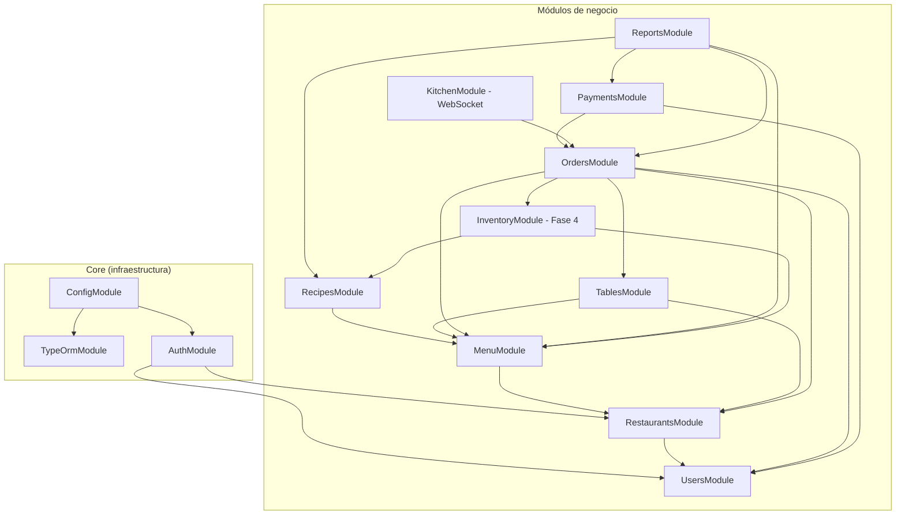

> [!IMPORTANT]
> La dirección de las flechas = "depende de". `OrdersModule` depende de `TablesModule` y `MenuModule`, pero **nunca al revés**. Esto evita dependencias circulares.

---

## 3. Flujos de Negocio (Secuencias)

### 3.1 — Flujo completo de un pedido (Dine-In)

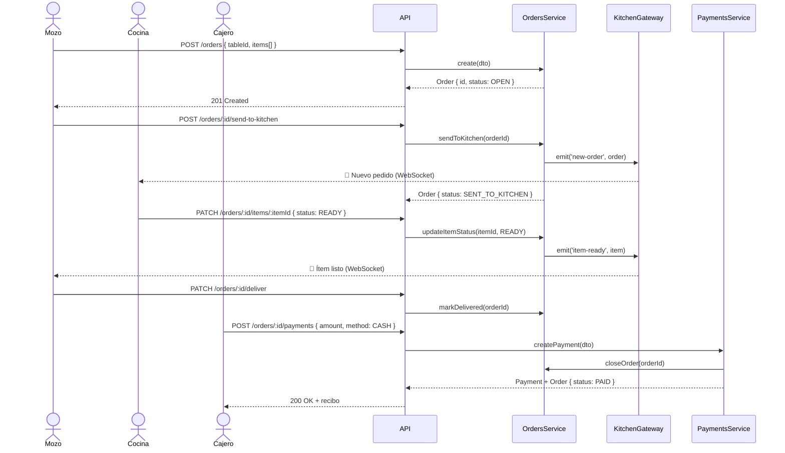

### 3.2 — Flujo de autenticación y autorización

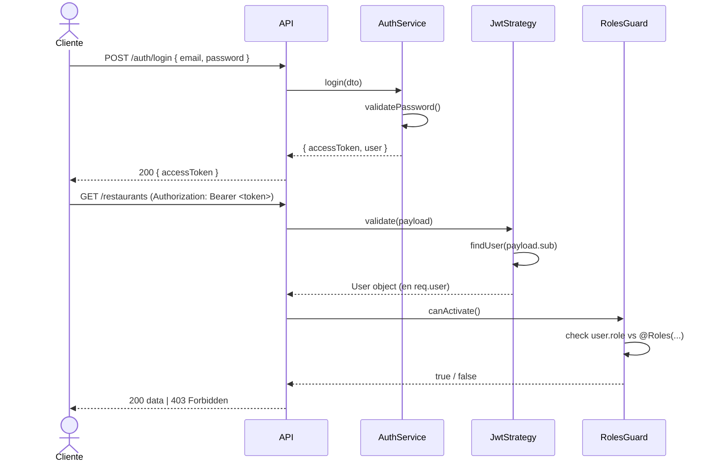

### 3.3 — Flujo de auto-pedido vía QR (comensal sin mozo)

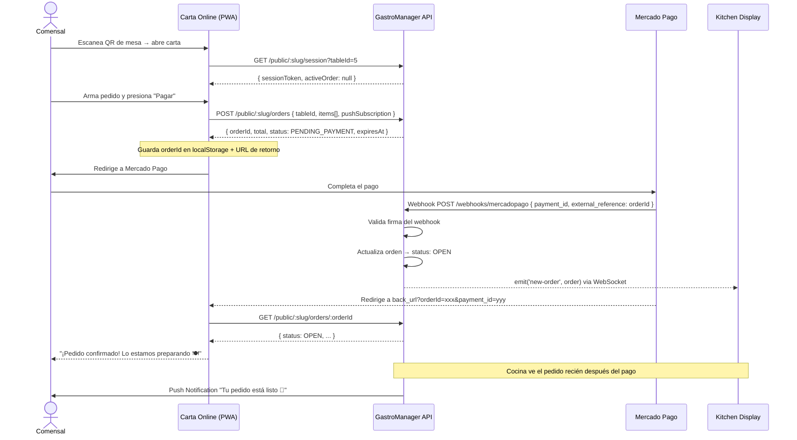

### 3.4 — Sesión de mesa y manejo de concurrencia (QR como ancla)

La URL del QR **nunca cambia** (es una calcomanía física en la mesa). La "sesión activa" se determina server-side por el estado de la orden más reciente de esa mesa:

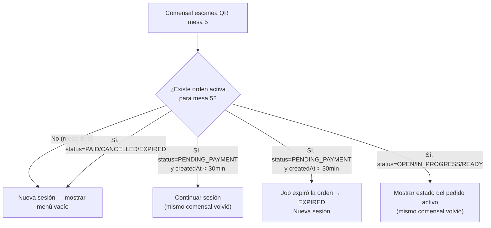

> [!IMPORTANT]
> El QR no lleva token de sesión. La sesión la gestiona el backend en base al estado de la última orden de la mesa. Cuando la mesa queda libre (PAID o EXPIRED), el próximo comensal siempre empieza desde cero — sin ver órdenes anteriores.

### 3.5 — Flujo de apertura y cierre de caja

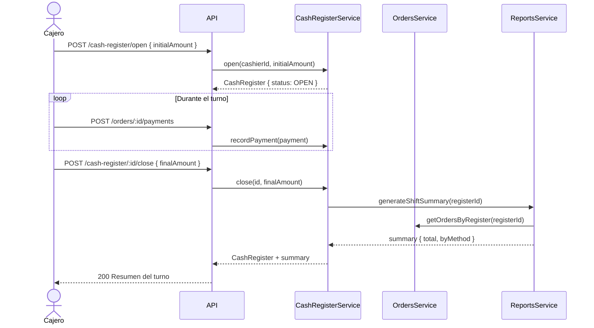

### 3.6 — Confirmación manual de pago (fallback de webhook)

Cubre el caso en que el webhook falla y el cliente le muestra al mozo el comprobante de pago en su dispositivo.

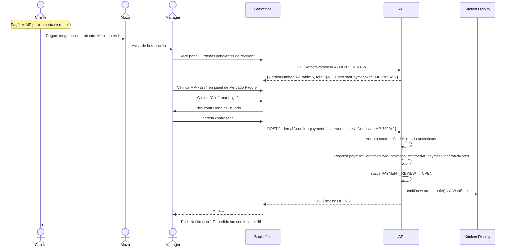

> [!IMPORTANT]
> La re-autenticación con contraseña en cada acción sensible (confirmación manual, rechazo, void de orden) garantiza **trazabilidad de caja**: el sistema registra inequívocamente qué usuario tomó la decisión, cuándo y con qué notas. Esto protege al negocio en disputas y auditorías.

---

## 4. Contratos de API — Endpoints por módulo

### Auth
| Método | Endpoint | Rol requerido | Descripción |
|--------|----------|---------------|-------------|
| `POST` | `/auth/register` | — | Registrar usuario |
| `POST` | `/auth/login` | — | Login, retorna JWT |
| `GET` | `/auth/me` | Autenticado | Perfil propio |

### Restaurants
| Método | Endpoint | Rol requerido | Descripción |
|--------|----------|---------------|-------------|
| `POST` | `/restaurants` | OWNER | Crear restaurante |
| `GET` | `/restaurants` | Autenticado | Listar todos |
| `GET` | `/restaurants/:id` | Autenticado | Ver detalle |
| `PATCH` | `/restaurants/:id` | OWNER, MANAGER | Editar |
| `DELETE` | `/restaurants/:id` | OWNER | Desactivar |

### Tables
| Método | Endpoint | Rol requerido | Descripción |
|--------|----------|---------------|-------------|
| `GET` | `/restaurants/:rid/zones` | Autenticado | Listar zonas |
| `POST` | `/restaurants/:rid/zones` | MANAGER | Crear zona |
| `GET` | `/restaurants/:rid/tables` | Autenticado | Listar mesas (con estado) |
| `POST` | `/restaurants/:rid/tables` | MANAGER | Crear mesa |
| `PATCH` | `/tables/:id/status` | WAITER | Cambiar estado |

### Menu
| Método | Endpoint | Rol requerido | Descripción |
|--------|----------|---------------|-------------|
| `GET` | `/restaurants/:rid/categories` | Autenticado | Listar categorías |
| `POST` | `/restaurants/:rid/categories` | MANAGER | Crear categoría |
| `GET` | `/restaurants/:rid/products` | Autenticado | Listar productos (con filtros) |
| `POST` | `/restaurants/:rid/products` | MANAGER | Crear producto |
| `PATCH` | `/products/:id/availability` | MANAGER, KITCHEN | Marcar disponible/no disponible |
| `POST` | `/products/:id/modifier-groups` | MANAGER | Agregar grupo de modificadores |

### Orders
| Método | Endpoint | Rol requerido | Descripción |
|--------|----------|---------------|-------------|
| `POST` | `/orders` | WAITER | Crear pedido |
| `GET` | `/orders` | WAITER, MANAGER | Listar pedidos activos |
| `GET` | `/orders?status=PAYMENT_REVIEW` | MANAGER, OWNER | Listar órdenes pendientes de confirmación manual |
| `GET` | `/orders/:id` | Autenticado | Ver pedido |
| `POST` | `/orders/:id/items` | WAITER | Agregar ítem |
| `DELETE` | `/orders/:id/items/:itemId` | WAITER, MANAGER | Quitar ítem |
| `POST` | `/orders/:id/send-to-kitchen` | WAITER | Enviar a cocina |
| `PATCH` | `/orders/:id/items/:itemId/status` | KITCHEN | Actualizar estado del ítem |
| `PATCH` | `/orders/:id/deliver` | WAITER | Marcar entregado |
| `POST` | `/orders/:id/cancel` | MANAGER | Cancelar pedido |
| `POST` | `/orders/:id/confirm-payment` | MANAGER, OWNER | ⚠️ Confirmar pago manualmente — requiere re-auth con contraseña |
| `POST` | `/orders/:id/reject-payment` | MANAGER, OWNER | ⚠️ Rechazar pago manualmente — requiere re-auth con contraseña |

### Payments
| Método | Endpoint | Rol requerido | Descripción |
|--------|----------|---------------|-------------|
| `POST` | `/orders/:id/payments` | CASHIER | Registrar pago |
| `GET` | `/orders/:id/payments` | Autenticado | Ver pagos de un pedido |
| `POST` | `/cash-register/open` | CASHIER | Abrir caja |
| `POST` | `/cash-register/:id/close` | CASHIER | Cerrar caja con resumen |

### Reports
| Método | Endpoint | Rol requerido | Descripción |
|--------|----------|---------------|-------------|
| `GET` | `/reports/sales` | OWNER, MANAGER | Ventas por rango de fechas |
| `GET` | `/reports/top-products` | OWNER, MANAGER | Productos más vendidos |
| `GET` | `/reports/by-waiter` | MANAGER | Ventas por mozo |
| `GET` | `/reports/cash-register/:id` | CASHIER, MANAGER | Resumen de caja |

### Public API — Carta online y auto-pedido (autenticación por API Key)

> [!NOTE]
> Estos endpoints son consumidos por la **carta online** desarrollada por un tercero. Requieren una API Key generada por el OWNER del restaurante desde el backoffice. La API Key identifica al restaurante y limita el acceso a sus propios datos públicos.

| Método | Endpoint | Auth | Descripción |
|--------|----------|------|-------------|
| `GET` | `/public/:slug/menu` | API Key | Menú completo: categorías + productos + modificadores |
| `GET` | `/public/:slug/categories` | API Key | Solo categorías activas |
| `GET` | `/public/:slug/products` | API Key | Productos disponibles (con filtros) |
| `GET` | `/public/:slug/session` | API Key | Estado de sesión de la mesa (¿hay orden activa?) |
| `POST` | `/public/:slug/orders` | API Key | Crear orden en estado `PENDING_PAYMENT` |
| `GET` | `/public/:slug/orders/:id` | API Key | Ver estado de una orden (para polling del cliente) |
| `POST` | `/webhooks/mercadopago` | Firma MP | Webhook de pago — confirma y activa la orden |
| `POST` | `/webhooks/generic` | Firma HMAC | Webhook genérico para otras pasarelas de pago |

> [!IMPORTANT]
> La API Key **nunca debe exponerse en el browser del comensal**. La carta online debe tener un backend propio que actúe de intermediario. Los endpoints `/public/*` son para servidor-a-servidor o para backends de cartas online, no para ser llamados directamente desde el frontend del comensal.

---

## 5. Estados y Transiciones

### Order Status — Máquina de estados

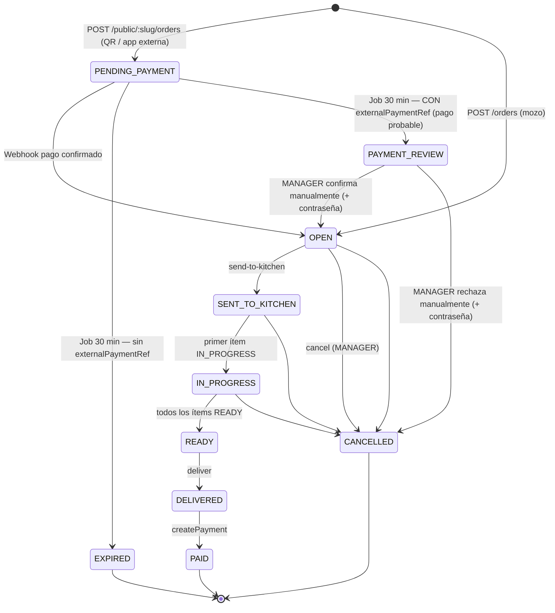

> [!NOTE]
> `PENDING_PAYMENT` y `EXPIRED` solo aplican a órdenes con `origin = QR` o `EXTERNAL_APP`. El kitchen display **nunca muestra** órdenes en estado `PENDING_PAYMENT`, `PAYMENT_REVIEW` ni `EXPIRED`. Las push notifications se envían al pasar a `OPEN` (pago confirmado) y a `READY` (pedido listo).
>
> La diferencia entre `EXPIRED` y `PAYMENT_REVIEW`: si a los 30 min la orden tiene `externalPaymentRef` (el cliente llegó a MP y probablemente pagó), pasa a `PAYMENT_REVIEW` para revisión manual del staff. Si no tiene referencia de pago (cliente abandonó antes de pagar), pasa directo a `EXPIRED`.

### Table Status

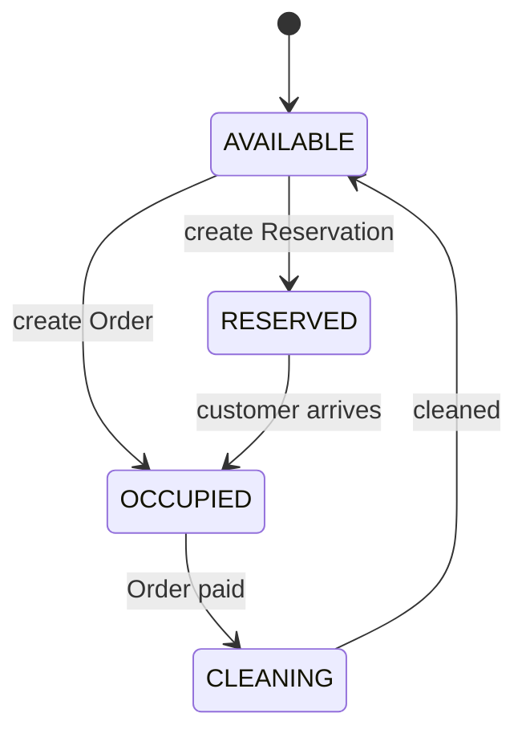

### OrderItem Status

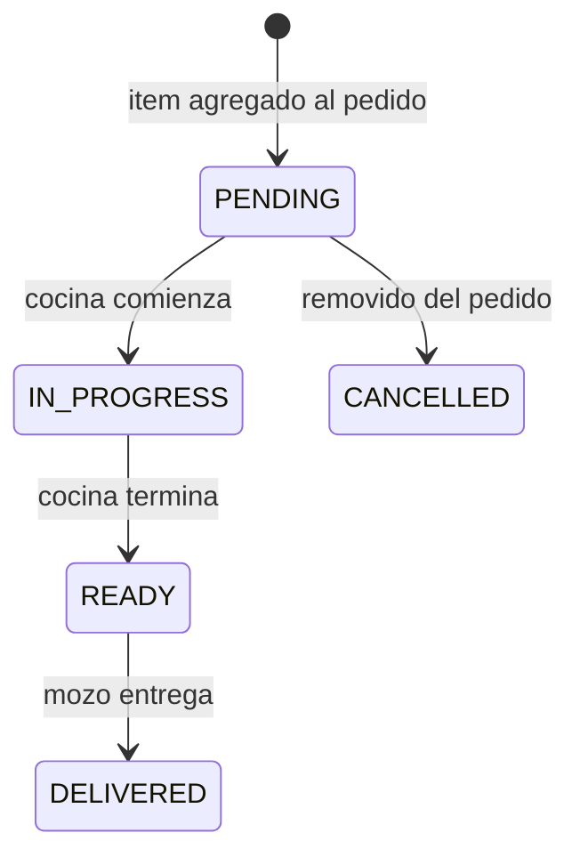

---

## 6. Reglas de Negocio Críticas

> [!IMPORTANT]
> Estas reglas **deben validarse en la capa de Service**, nunca solo en el DTO.

| # | Regla | Módulo | Dónde validar |
|---|-------|--------|---------------|
| R1 | Un pedido solo puede editarse si está en estado `OPEN` | Orders | `OrdersService.addItem()` |
| R2 | No se puede pagar un pedido si no está en `DELIVERED` | Payments | `PaymentsService.create()` |
| R3 | Una mesa `OCCUPIED` no puede recibir un nuevo pedido | Orders | `OrdersService.create()` |
| R4 | El total del pago debe cubrir el total del pedido | Payments | `PaymentsService.create()` |
| R5 | Solo el `OWNER` puede crear/eliminar productos y categorías | Menu | `RolesGuard` |
| R6 | Un `WAITER` solo ve los pedidos de su restaurante | Orders | `OrdersService.findAll()` |
| R7 | El slug de restaurante es único en todo el sistema | Restaurants | `RestaurantsService.create()` |
| R8 | Un usuario pertenece a un solo restaurante a la vez | Users | `UsersService.assignToRestaurant()` |
| R9 | No se puede cerrar caja si hay pedidos abiertos | CashRegister | `CashRegisterService.close()` |
| R10 | El precio del ítem se fija al momento de crear el pedido | Orders | `OrdersService.addItem()` |
| R11 | El kitchen display nunca muestra órdenes `PENDING_PAYMENT` ni `EXPIRED` | Kitchen | `KitchenGateway` — filtrar por estado |
| R12 | Una orden `PENDING_PAYMENT` expira automáticamente a los 30 min | Orders | Job `@nestjs/schedule` — `OrdersService.expireStale()` |
| R13 | La sesión de mesa activa es la última orden no expirada/pagada de esa mesa | Orders | `OrdersService.getActiveSessionForTable()` |
| R14 | Un nuevo comensal nunca ve órdenes anteriores — la sesión se resetea cuando la orden pasa a `PAID`, `CANCELLED` o `EXPIRED` | Orders | `OrdersService.getActiveSessionForTable()` |
| R15 | La API Key de un restaurante solo puede acceder a los datos de ese restaurante | Public API | `ApiKeyGuard` — valida `restaurantId` del token vs recurso |
| R16 | Confirmar o rechazar un pago manualmente requiere re-autenticación con contraseña del usuario que ejecuta la acción | Orders | `OrdersService.confirmPayment()` — verifica password antes de proceder |
| R17 | Toda confirmación manual queda auditada: `paymentConfirmedById`, `paymentConfirmedAt`, `paymentConfirmedNotes` inmutables una vez registrados | Orders | `OrdersService.confirmPayment()` |
| R18 | Si a los 30 min la orden `PENDING_PAYMENT` tiene `externalPaymentRef` → pasa a `PAYMENT_REVIEW` (revisión manual). Si no tiene referencia → pasa a `EXPIRED` (cliente abandonó sin pagar) | Orders | Job `OrdersService.expireStale()` |
| R19 | Solo MANAGER u OWNER pueden ver y actuar sobre órdenes en `PAYMENT_REVIEW`. El WAITER no tiene acceso | Orders | `RolesGuard` en endpoints de confirmación |
| R20 | Las recetas y los costos de insumos son internos — nunca se exponen en la Public API ni en la carta del comensal | Recipes | `RecipesController` sin ruta pública |
| R21 | El costo del producto se recalcula automáticamente cuando cambia el `unitCost` de un ingrediente o se modifica su receta | Recipes | `RecipesService.recalculateCost()` |
| R22 | Un ingrediente no puede eliminarse si está siendo usado en alguna receta activa | Recipes | `IngredientsService.remove()` |
| R23 | El descuento de stock por venta (Fase 4) solo aplica cuando la orden pasa a `OPEN` — nunca en `PENDING_PAYMENT` | Inventory | `InventoryService.deductFromOrder()` |

---

## 7. Decisiones Técnicas (ADR)

### ADR-001: Multi-tenancy por `restaurantId` en cada entidad
**Decisión:** Cada entidad de negocio tiene `restaurantId` como FK.
**Alternativa descartada:** Schemas separados por restaurante en PostgreSQL.
**Razón:** Más simple de implementar y escalar en esta etapa. Con Row-Level Security de Postgres podemos aislar datos igualmente.

### ADR-002: Soft delete en lugar de hard delete
**Decisión:** `isActive: false` en lugar de `DELETE FROM`.
**Razón:** Preservar historial de pedidos y reportes. Un producto eliminado que estuvo en pedidos históricos debe seguir siendo consultable.

### ADR-003: Precio fijado en el `OrderItem`
**Decisión:** `unitPrice` se copia del `Product.price` al momento de crear el ítem.
**Razón:** Si el precio del producto cambia, los pedidos históricos no deben verse afectados.

### ADR-004: WebSocket solo para Kitchen Display
**Decisión:** Solo el módulo de cocina usa WebSockets. El resto es REST polling o HTTP.
**Razón:** Reduce complejidad. El kitchen display necesita tiempo real; el resto puede tolerar latencia de 1-2 segundos.

### ADR-005: `synchronize: true` solo en desarrollo
**Decisión:** En producción usar migraciones TypeORM explícitas.
**Razón:** `synchronize: true` puede borrar columnas accidentalmente.

### ADR-006: Estado `PENDING_PAYMENT` para desacoplar creación de orden y confirmación de pago
**Decisión:** Las órdenes creadas desde canales externos (QR, app de carta) nacen en estado `PENDING_PAYMENT` y solo pasan a `OPEN` tras la confirmación del webhook de la pasarela de pago.
**Alternativa descartada:** Crear la orden directamente en `OPEN` y cancelarla si el pago falla.
**Razón:** La cocina nunca debe ver un pedido sin pago confirmado. Con `PENDING_PAYMENT` como estado inicial el flujo es atómico: si el webhook no llega en 30 min, la orden expira y la mesa queda libre automáticamente. Elimina la necesidad de almacenamiento temporal externo (Redis, Upstash, etc.).

### ADR-007: La mesa como ancla de sesión (QR estático, sesión server-side)
**Decisión:** La URL del QR es estática y permanente (`/mesa/5`). La "sesión activa" del comensal se determina consultando la última orden no finalizada de esa mesa.
**Alternativa descartada:** QR con token rotativo (token embebido en la URL que cambia por sesión).
**Razón:** Un QR rotativo requiere reemplazar la calcomanía física o usar un QR dinámico de pago. Con sesión server-side el QR puede ser una calcomanía impresa para siempre. El backend determina si hay sesión activa por estado de la orden, no por el token de la URL.

### ADR-008: PWA Push Notifications para estado del pedido
**Decisión:** La carta online (desarrollada por terceros) debe implementarse como PWA con Service Worker. GastroManager almacena la `pushSubscription` del browser junto con la orden y envía notificaciones push cuando el estado cambia a `OPEN` (pago confirmado) y `READY` (pedido listo).
**Alternativa descartada:** Polling periódico del cliente al endpoint de estado.
**Razón:** El Push Notification funciona con el browser/app cerrado, sin costo de infraestructura adicional y sin que el comensal provea datos personales. El polling genera carga innecesaria y no funciona con la app cerrada.

### ADR-009: Step-up authentication para acciones sensibles de caja
**Decisión:** Las acciones que afectan la trazabilidad contable del local (confirmación manual de pago, rechazo de pago, void de orden ya cerrada) requieren que el usuario re-ingrese su contraseña en el momento de ejecutarlas, aunque ya tenga sesión activa (JWT válido).
**Alternativa descartada:** Confiar solo en el JWT existente + el rol del usuario.
**Razón:** El JWT puede estar activo en un browser desatendido. La re-autenticación garantiza que fue una acción intencional de la persona correcta. Además, genera un registro inmutable (`paymentConfirmedById` + `paymentConfirmedAt` + notas) que protege al negocio en disputas, auditorías o inspecciones fiscales. Es el estándar en sistemas POS: los "manager overrides" siempre requieren PIN o contraseña.

### ADR-010: Recetas separadas de Inventario aunque comparten el modelo de Insumos
**Decisión:** `RecipesModule` (gestión de recetas y cálculo de costos) se implementa en Fase 3 de forma independiente de `InventoryModule` (Fase 4). Ambos usan la misma entidad `INGREDIENT` y `RECIPE_ITEM`, pero son módulos distintos.
**Alternativa descartada:** Implementar recetas e inventario juntos en una sola fase.
**Razón:** El cálculo de costos (recetas) aporta valor inmediato al dueño del restaurante desde Fase 3 sin necesidad de rastrear stock. El descuento automático de stock al confirmar una orden es funcionalidad adicional que se activa sola en Fase 4 sin romper el modelo existente. Separar los módulos permite entregar valor incremental y reduce el riesgo de Fase 3.

---

## 8. Estado de Implementación

| Módulo | Entidad | Service | Controller | Tests | Migraciones |
|--------|---------|---------|------------|-------|-------------|
| Auth | ✅ | ✅ | ✅ | ✅ | — |
| Restaurants | ✅ | ✅ | ✅ | ✅ | — |
| Users | ✅ | ✅ | ✅ | ✅ | — |
| Zones | ✅ | ✅ | ✅ | ✅ | — |
| Tables | ✅ | ✅ | ✅ | ✅ | — |
| Menu/Categories | ✅ | ✅ | ✅ | ✅ | — |
| Menu/Products | ✅ | ✅ | ✅ | ✅ | — |
| Modifiers | ✅ | ✅ | ✅ | ✅ | — |
| Orders | ⬜ | ⬜ | ⬜ | ⬜ | — |
| Order Items | ⬜ | ⬜ | ⬜ | ⬜ | — |
| Payments | ⬜ | ⬜ | ⬜ | ⬜ | — |
| Cash Register | ⬜ | ⬜ | ⬜ | ⬜ | — |
| Kitchen WS | ⬜ | ⬜ | ⬜ | ⬜ | — |
| Reports | ⬜ | ⬜ | ⬜ | ⬜ | — |
| **Ingredients** | ⬜ | ⬜ | ⬜ | ⬜ | — |
| **Recipes** | ⬜ | ⬜ | ⬜ | ⬜ | — |
| **Public API** | — | ⬜ | ⬜ | ⬜ | — |
| **API Keys** | ⬜ | ⬜ | ⬜ | ⬜ | — |
| **Webhooks (MP)** | — | ⬜ | ⬜ | ⬜ | — |
| **Push Notifications** | — | ⬜ | — | ⬜ | — |
| **Expire Job (schedule)** | — | ⬜ | — | ⬜ | — |
| **Inventory (Fase 4)** | ⬜ | ⬜ | ⬜ | ⬜ | — |

✅ Hecho · 🔄 En progreso · ⬜ Pendiente
